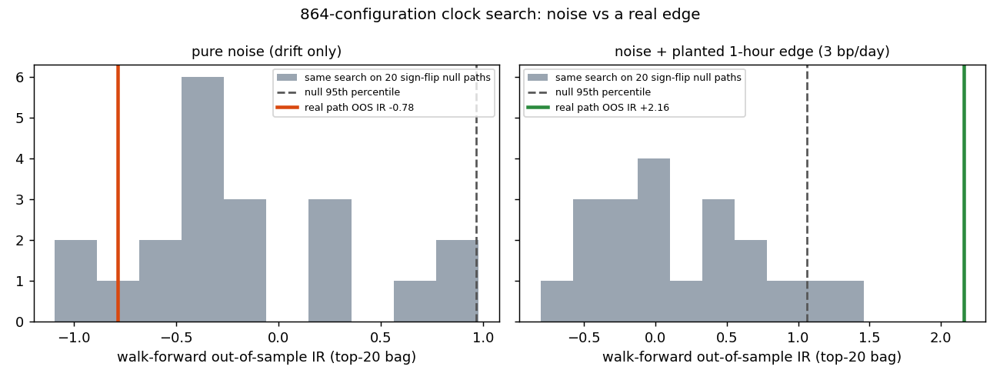
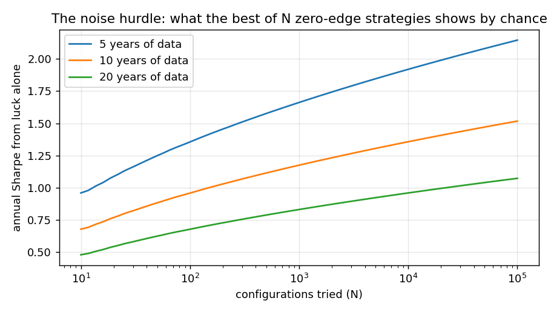

# nullsearch: would your strategy search find this edge in pure noise?

[](https://github.com/Tolbert-Okoth/backtest-null-search/actions/workflows/tests.yml)


Every brute-force search (parameter grids, indicator combinations, "best hour to trade" scans, ML hyper-parameter sweeps) produces a winner. The question that matters is whether that winner is better than what **the same search produces on data with no edge in it**.

`nullsearch` answers it in three ways:
- **Sign-flip null paths:** your exact price series with every move's direction randomised. Volatility, gaps, intraday shape and drift are kept; every directional pattern is gone.
- **Selection-bias statistics:** the noise hurdle √(2 ln N)/√years, the **Deflated Sharpe Ratio**, the **Probabilistic Sharpe Ratio** and the **Probability of Backtest Overfitting** (CSCV).
- **A transparent reference search:** a walk-forward "clock" search (entry hour × hold × side × weekday) with top-K bagging. Run it on real and null paths and compare.



## What the demo shows (synthetic data, `python examples/headline.py`)
| Path | Configurations searched | Real out-of-sample IR | Null 95th percentile | Verdict |
|---|---|---|---|---|
| Pure noise with drift | 864 | **−0.78** | +0.97 | indistinguishable from noise ✔ |
| Noise + a planted 1-hour edge (3 bp/day) | 864 | **+2.16** | +1.06 | real edge detected ✔ |

The same walk-forward machine that "finds" edges in noise produces out-of-sample results inside the null band. A genuine, small, persistent effect clears it.



**The noise hurdle in practice:** with 10,000 configurations and 10 years of data, the best zero-edge strategy shows an annual Sharpe of about **1.36 from luck alone**. Most published "strategy discoveries" never report N.

## Why I built it
In my own research I ran a 33,120-configuration clock search on three liquid markets (gold, a US tech-index CFD, USD/JPY) over 10–17 years.
- **Without a null test:** two of the three looked like tradeable timing edges out of sample.
- **Against sign-flip nulls:**
  - one was indistinguishable from what the search finds in the index's own drift;
  - one was pure noise;
  - only one sat at the edge of significance.

That re-test changed which ideas I spend time on. It's the check I now run before any search result is trusted.

## Quick start
```bash
pip install "git+https://github.com/Tolbert-Okoth/backtest-null-search.git#egg=nullsearch[plot]"
```
```python
import pandas as pd, nullsearch as ns

prices = pd.read_csv("my_prices.csv", index_col=0, parse_dates=True)["close"]   # your own data, any bar size <= 1h
out = ns.null_test(prices, cuts=["2019-01-01", "2021-01-01", "2023-01-01"], n_null=20)
print(out["real_ir"], out["null_p95"], out["passes"])

# statistics on any return series you already have
dsr, sr0 = ns.deflated_sharpe(daily_returns, n_trials=5_000)     # P(true Sharpe > best-of-N luck), and that hurdle
pbo = ns.pbo_cscv(perf_matrix, n_splits=16)                       # T x N matrix of per-period returns of every config
```

## API
| Function | What it does |
|---|---|
| `sign_flip(prices, seed)` | Null path: same timestamps and absolute moves, drift kept, directions randomised |
| `block_shuffle_days(prices, seed)` | Null for multi-day rules (keeps each day's shape) |
| `clock_matrix(prices, hours, holds, weekdays, cost_bp)` | Daily net returns of every clock configuration |
| `walk_forward_bag(matrix, days, cuts, k)` | Stitched out-of-sample returns of the in-sample top-k |
| `null_test(prices, cuts, n_null, ...)` | The full real-vs-null comparison |
| `noise_hurdle(N, years)` | Best-of-N Sharpe from luck |
| `deflated_sharpe(returns, n_trials)` | DSR probability + annual hurdle SR0 |
| `probabilistic_sharpe(returns, sr_benchmark)` | PSR |
| `pbo_cscv(perf, n_splits)` | Probability of backtest overfitting |

## Who this is for
- **Systematic traders and prop-firm candidates:** before risking capital on a backtest winner.
- **Quant researchers and reviewers:** a quick, defensible "is this data-mined?" check for strategy reports.
- **Teams and clients:** I offer backtest audits (selection bias, cost realism, out-of-sample design) using this toolkit. Contact via my GitHub profile.

## Data and licensing
- **This repository contains no market data.** All figures are generated from synthetic, randomly generated price paths by `examples/headline.py`.
- Use the tools with **data you are licensed to use**; nothing here downloads or redistributes vendor data.
- Methods follow published academic work (cited below). No text or code is copied from those sources.
- Code: MIT License (see `LICENSE`).

## References
- Bailey, D. H. & López de Prado, M. (2014). *The Deflated Sharpe Ratio.* Journal of Portfolio Management.
- Bailey, D. H., Borwein, J., López de Prado, M. & Zhu, Q. J. (2017). *The Probability of Backtest Overfitting.* Journal of Computational Finance.
- López de Prado, M. (2018). *Advances in Financial Machine Learning*, ch. 11–14. Wiley.

## Disclaimer
Research and educational software. Not investment advice, and no warranty: see `LICENSE`. Past or simulated performance does not guarantee future results.
